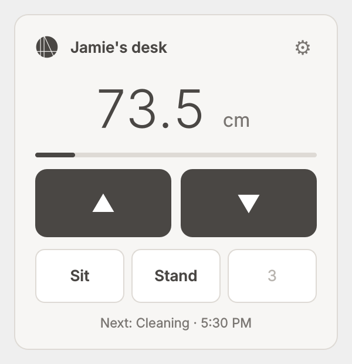
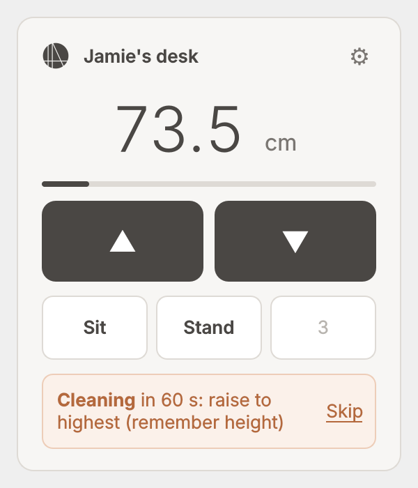
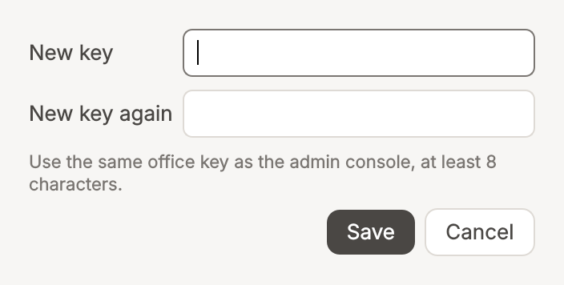
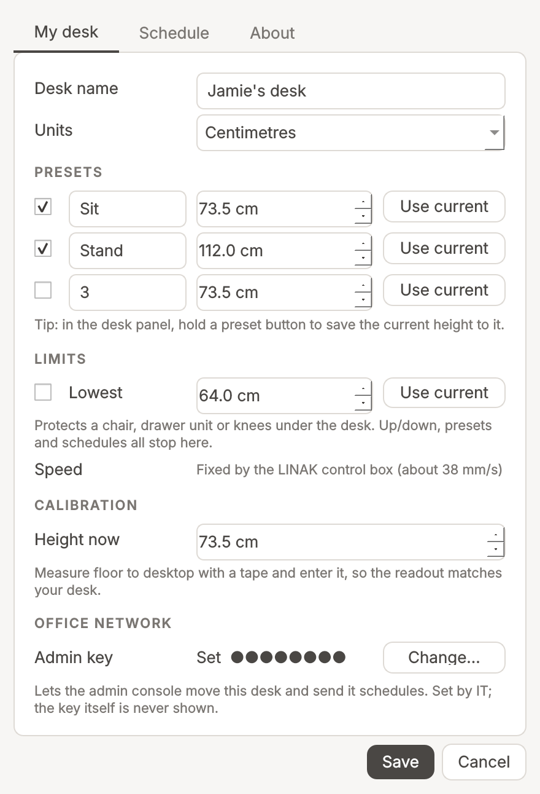
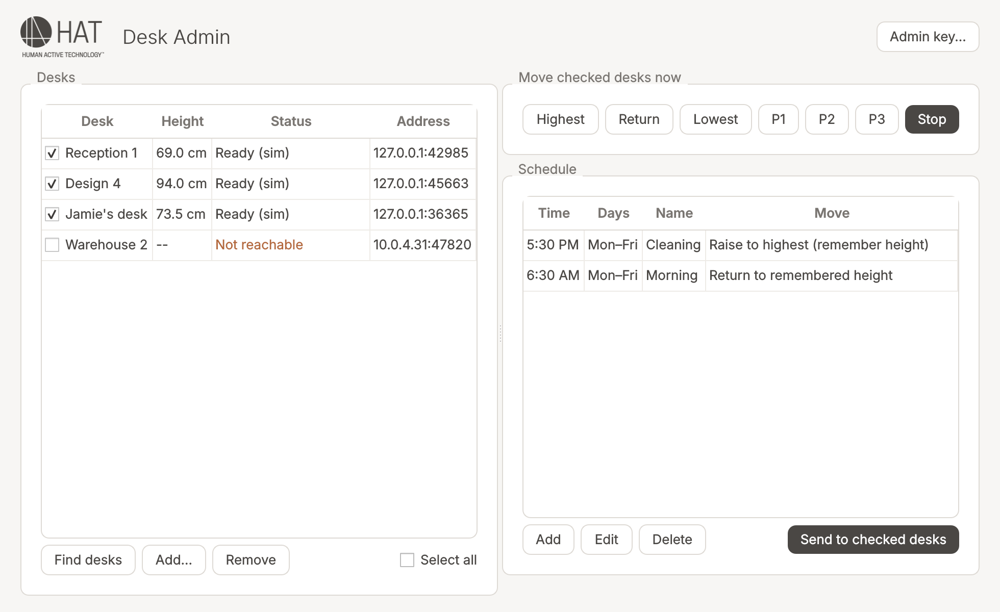

# HAT Desk app

A small Windows tray app for each sit-stand desk, plus an admin console that controls many
desks at once and sets clock schedules (for example, all desks up at 5:30 PM for cleaning and
back down before people arrive). It is built on the `linak_leg` package in this repo, which
drives the LINAK DL6 leg through the CBD6S control box and the USB2LIN06 cable.

 

## How it fits together

```
 Desk PC (every desk)                                   Admin PC (facilities)
┌───────────────────────────────────┐                  ┌──────────────────────────┐
│ HAT Desk tray app                 │   office LAN     │ HAT Desk Admin           │
│  ├ panel: ▲ ▼, 3 presets          │◄────────────────►│  find desks (broadcast)  │
│  ├ scheduler (runs on this clock) │  HTTP :47820     │  move checked desks      │
│  ├ agent (admin key required)     │  UDP  :47821     │  edit + send schedules   │
│  └ linak_leg ── USB2LIN06 ── CBD6S ── DL6 legs       └──────────────────────────┘
└───────────────────────────────────┘
```

- **Schedules run on each desk**, on that PC's clock. The admin sends them once; after that the
  desk does not need the admin PC or the network. If the PC was asleep at 5:30 PM, the move
  still runs up to 20 minutes late, never later.
- **Before a scheduled move** the desk shows a notice for 60 s (adjustable) with **Skip**, so
  someone working late is not surprised.
- **"Raise to highest" remembers the height** the desk was at. "Return to remembered height" in
  the morning puts it back. A second "raise" doesn't overwrite the remembered height.
- **Everything goes through `linak_leg`**: the low limit, hold-to-move watchdog, 20 s hold limit
  and the DL6 duty cycle (2 min in 18 min) apply to manual, preset, admin and scheduled moves.

## Roles

| | User (tray app on their desk) | Admin (admin console) |
| --- | --- | --- |
| Up / down, presets | ✓ own desk | ✓ any checked desks |
| Program presets, low limit, units, calibration | ✓ | |
| See schedules, skip one today | ✓ | |
| Create and send schedules | | ✓ |
| Speed | fixed by the CBD6S (about 38 mm/s), not settable over USB2LIN06 | |

The admin key is what separates the two: each desk accepts network commands only with the
office admin key. IT sets it once per desk (in settings or on the command line), and the desk
app never shows it.

## Using it

### On each desk PC

1. Install Python 3.10+ (python.org, tick "Add to PATH").
2. Copy this repo to the PC, plug the USB2LIN06 cable into the CBD6S, close LINAK's Desk Control
   app (only one program can use the cable).
3. Double-click `HAT_DESK.bat`. The HAT mark appears in the tray. Click it for the panel.
   Windows Firewall asks once about network access; allow **private networks** so the admin
   console can reach the desk.
4. Set the office admin key once: click the HAT mark, then **⚙ → My desk → Office network →
   Admin key → Set...**, and type the key twice. It's saved right away.
   Or from a Command Prompt in the app folder, for scripted installs:
   `python -m hat_desk --admin-key YOUR-OFFICE-KEY`

The key is never shown in the app, only whether one is set. Once it is set, changing it in
settings asks for the current key, so a desk's user can't casually cut the desk off from the
admin console and its cleaning schedule. This is a guard, not a lock: the settings file lives
in the user's own `%APPDATA%`, and the command line can still overwrite the key.



In the panel: hold ▲ / ▼ to move. Click a preset to go there; **hold a preset for a second
to save the current height** to it (or right-click for Save / Rename). ⚙ opens settings:
preset names and heights, the lowest allowed height, units, and calibration (measure the desk
with a tape once so the readout is right).



The app starts with Windows (setting in ⚙). Settings live in `%APPDATA%\HAT Desk\`.

### Admin console

Double-click `HAT_DESK_ADMIN.bat`, enter the same office admin key, then **Find desks** (or
**Add...** by PC name / IP if the network blocks broadcasts). Check the desks you want, then
use **Move checked desks now** or edit the **Schedule** and **Send to checked desks**. It
starts with two rules: Cleaning 5:30 PM Mon–Fri raise to highest, and Morning 6:30 AM Mon–Fri
return to remembered height.



### Try it without a desk

`python -m hat_desk --sim` runs the tray app on the simulated control box and leg.

## Tests

```
pip install pytest PySide6
python -m pytest tests_desk
```

Settings, presets, the low limit, max/restore, the scheduler (time, days, skip, grace window,
desk in use, offline retry) and the network agent (admin key, actions, schedules, bad input),
against `SimulatedLeg`.

## Before using it in the office

- **Bench test `go_to`.** Presets, schedules and admin moves use the box's position mode,
  which has not been tried on real hardware yet (hold-to-move has).
- **Unattended moves.** Scheduled moves happen with nobody at the desk. Check nothing can be
  caught: chairs and drawer units under the desk, monitor arms against walls or shelves. LINAK
  offers anti-collision for the CBD6S; worth asking about before scheduling a whole floor.
- **Network.** Commands are plain HTTP on the office LAN, protected by the admin key. Keep
  port 47820 closed to the internet.
